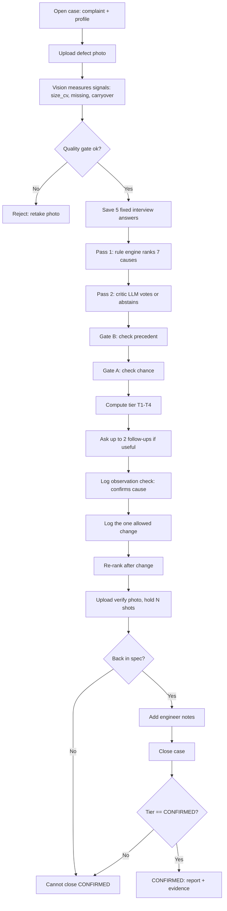

# Q&A bank — likely judge questions, short answers

Three minutes of Q&A goes fast: answer in one or two sentences, then stop. Each answer
names the backup slide (9–13) or the screen that shows it. The judges are industry
people from NSW Automation, so lead with what it does on a line, then how.

---

**1. Why not just ask ChatGPT, or a vision model, what's wrong?**
Because an engineer can't argue with a number nobody can trace. Every percentage here is
built from cited rules (*Why 59%?*). We also benchmarked small local vision-language
models on our defect images: 13.6%, every real defect missed. The LLM is used where it's
good — a second opinion, mapping free text, writing the summary — and can never set a
likelihood.

**2. Where do the weights come from? Did you fit them?**
From the NPL Best Practice Guide's sections and the NSW brief, with team judgement on
size. They were deliberately *not* fitted, because fitting to synthetic data would just
learn the generator. We measure calibration instead: at ★★★ it's right 95% of the time,
at ★ 52% (slide 5).

**3. You have no real photos. How do you know the vision works?**
We don't claim real-photo accuracy, and say so on the slides. What we measured:
- 6,600 synthetic photos, damaged the way cameras damage them;
- framing, tilt and a desk in the shot measure as well as clean photos;
- glare and heavy clutter are refused rather than misread (slide 11).

Validating on 50–100 real NSW photos is step one of the pilot.

**4. What if the cause isn't one of your seven?**
It says "no cause is ahead" instead of guessing, and the operator can escalate to an
engineer; the home page lists cases waiting for one. Stringing and smearing (up height, NPL §3.3) is the next cause we'd add (slide 13).

**5. Isn't the "learning database" just counting?**
The count is descriptive on purpose. What makes it trustworthy is what gets *in*: only
cases where one change was made and the fix was re-measured close CONFIRMED. History can
lower confidence in a cause past cases contradict, never raise it, so it can't grow
overconfident by repetition (slides 7 and 9).

**6. What if the LLM hallucinates, or there's no internet?**
It can't change a likelihood, and every source it cites is checked against the rules it
was given; if not, the code-written explanation is shown instead. Without internet, one
failed call switches it off for two minutes. The whole system runs fully offline, and we
can demo it that way.

**7. How would NSW deploy it? What does it need?**
A line PC or a laptop. No GPU, no training data, no cloud required. Operators use any
browser, including a phone on the line's Wi-Fi. Data stays in one database file on site.
Next steps would be a recipe import from the dispenser program and a hook to open cases
from SPC alarms.

**8. What if the operator answers badly?**
The evaluation simulates exactly that. With half the answers random, the photo still
keeps it at 57% versus 40% without (slide 10). "Don't know" is always allowed and adds
no evidence, instead of a guess entering as fact.

**9. Isn't this just a 1990s expert system?**
The rule core, yes — on purpose, because it's auditable. What's new around it:
- the photo is measured and lined up with the recipe automatically;
- follow-ups are chosen by how much each answer would move the ranking;
- a chance test stops it reading patterns into noise;
- a critic can veto, and confidence is measured against outcomes;
- the case history only learns from proved fixes.

**10. Can an operator just mark a case as fixed?**
No. The close tier is computed from the check log and the re-measurement, and the
API refuses direct edits to it. Three changes at once, or a change aimed at a different
cause than the one confirmed, can't close CONFIRMED.

**11. Your accuracy numbers come from your own scenario cards — isn't that circular?**
Partly, and the evaluation README says so. The cards were written from the manual, not
from the rules, and include answers no rule rewards; the numbers test consistency with our
reading of the manual. The measurement and stress results aren't circular: their truth
comes from the image generator. An NSW engineer reviewing the cards would make the
diagnosis numbers much stronger.

**12. Can it predict defects before they happen?**
Not yet. The pieces are there, though: every case stores measured size spread with a
timestamp, so a line's spread can be trended and a case opened before it leaves spec.
That's on the pilot plan (slide 8).

**13. What does "p = 0.010" mean on the carryover case?**
The chance of seeing that many small-then-big pairs if oversized dots fell at random.
Below 0.05 we treat the pattern as real; at 0.62, as in another sample, it's noise, and
the system says so.

**14. How is this different from automated optical inspection (AOI)?**
AOI says *what* is wrong with a board. This says *why*, what to check first, and whether
the fix worked. It could take an AOI result as its photo input.

**15. What about other materials and patterns — lines, underfill, silicone?**
Profiles carry the recipe's geometry. Dots, grids, perimeters and custom patterns are
supported, and material and dispenser type are case metadata. Lines measure, but
start/end defects on a single row are a known gap. The causes come from the NPL guide's
dot-dispensing sections.

**16. What would you do with another month?**
Real photos from NSW, a bare-board reference to remove clutter false alarms, rules as data that engineers approve, and the up-height cause.

**17. Who did what? / Is this your own work?**
Slide 12 separates our work from what we used, as rule c.2 asks. Have each team member name the part they can explain in depth — the briefing asks that every member understands the solution.

**18. Every rule belongs to one cause — isn't that rigid?**
Less than it looks. One answer can move several causes up or down: "it has always been like this" raises board bending and lowers blockage and wear. A rule can also read combinations,such as missing dots *without* the carryover pattern. The real limit is that we set the weights from the manual. Next, the rules become a table NSW engineers can edit. Once there are enough proved cases, the weights get fitted from them in the same structure, so every % still shows its reasons.

**19. Air is confirmed — why does pressure-time still show a high %?**
Each % is per cause, as in the brief's own table, because two faults can happen together.
Confirming air doesn't prove the pressure is stable. The fresh photo does: size spread back
from 0.49 to 0.05.
